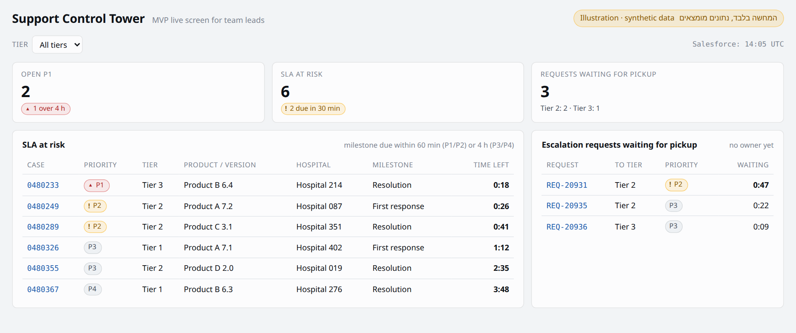

# Support Control Tower: פיתוח פנימי על גבי Spotfire

| | |
|---|---|
| **גרסה** | 2.0 (מחליפה את החלופה "פיתוח מאפס") |
| **תאריך** | 2026-10-12 |
| **בעלים** | מנהל התמיכה הטכנית |
| **מה זה** | ה-MVP המקוצר (גרסה 2.0) נבנה ב-Spotfire Cloud הקיים, על ידי מפתח ו-DBA מהארגון, עם התאמות (customization) במקום שבו Spotfire לא נותן את הצורך מהקופסה |
| **מה לא משתנה** | Salesforce נשארת מערכת התמיכה. ה-DW (שמתעדכן בזמן אמת) נשאר מקור הנתונים. ההיקף זהה ל-MVP 2.0 |
| **החלטות שהתקבלו** | יש Spotfire, ולא מפתחים מאפס. אחרי העלייה לאוויר: מפתח ו-DBA מתחזקים ומפתחים את הגלים הבאים |

---

## 0. תקציר והמלצה

| | Spotfire עם יועץ חיצוני (MVP 2.0) | **Spotfire עם פיתוח פנימי (המסמך הזה)** | פיתוח מאפס (הוסר) |
|---|---|---|---|
| מי בונה | יועץ חיצוני | מפתח ו-DBA מהארגון | צוות פיתוח |
| זמן עד עלייה לאוויר | כ-4 שבועות | כ-5 שבועות (כולל עקומת למידה) | כ-7 שבועות |
| רישיונות | קיימים | קיימים, ועוד רישיון author למפתח (לבדיקה) | אין |
| הידע אחרי העלייה | אצל היועץ, ותלוי בהעברה מסודרת | בבית מהיום הראשון | בבית |
| גלים אנליטיים | גרפים מובנים | גרפים מובנים | כל גרף בקוד, פי 2 בערך |
| תחזוקה | IT, עם תלות ביועץ | כ-0.2 משרת מפתח ו-0.1 משרת DBA | כ-0.3 משרת מפתח ו-0.1 משרת DBA, וכל הקוד שלכם |

**ההמלצה:** זו החלופה הנכונה. היא משאירה את הידע בבית כמו פיתוח מאפס, אבל משתמשת בכל מה ש-Spotfire כבר נותן: גרפים, מסננים, הרשאות, תצוגה לטלפון ודוחות. את הקוד כותבים רק במקום שבו אין ברירה.

**שני תנאים כדי שזה יעבוד:**
1. **בדיקת היתכנות בשבוע 1.** צריך לוודא ש-Spotfire Cloud שלכם מאפשר את ההתאמות שהמסך החי צריך, ובראשן רענון אוטומטי בלי לחיצה (סעיף 3, C1). זה הסיכון הטכני היחיד שיכול לשנות את התוכנית.
2. **המפתח צריך ידע ב-Spotfire.** אם אין לו ניסיון, צריך הדרכה של כמה ימים או ליווי קצר של מומחה. זה זול בהרבה מיועץ שבונה הכול.

---

## 1. שכבות ההתאמה ב-Spotfire, מהפשוטה למורכבת

**הכלל:** משתמשים תמיד בשכבה הנמוכה ביותר שפותרת את הצורך. כל שכבה מעל מוסיפה תחזוקה, ובשכבות העליונות גם סיכון שעדכון של Spotfire ישבור משהו.

| שכבה | מה זה | מי | סיכון בעדכון גרסה |
|---|---|---|---|
| **L0: הגדרה מובנית** | טבלאות in-database, עמודות מחושבות, custom expressions, גרף KPI, טבלה עם קישורים, צביעה מותנית, פריסה לטלפון | מפתח | אין |
| **L1: views ב-DW** | הגדרות המדדים כ-SQL. Spotfire רק מציג | DBA | אין |
| **L2: סקריפטים ב-IronPython** | פעולות שמופעלות מכפתור או מאירוע, למשל רענון טבלאות, ניווט ואיפוס מסננים | מפתח | נמוך-בינוני. **לאמת שזה נתמך ב-Spotfire Cloud** |
| **L3: JavaScript ב-Text Area** | למשל טיימר שמפעיל רענון, ועיצוב מיוחד | מפתח | **גבוה.** Spotfire לא מתחייב לתאימות בין גרסאות, אם משתמשים במשהו מעבר ל-API הציבורי |
| **L4: Mods** | הרחבות רשמיות ב-JavaScript/TypeScript: Visualization mods (מגרסה 11) ו-Action mods (מגרסה 14.4) | מפתח | נמוך. זה המנגנון הרשמי, והוא נבנה לענן |
| **L5: Data functions (Python)** | חישובים מתקדמים, למשל זיהוי דפוסי מוצר בגל השני | מפתח | נמוך |

---

## 2. ההיקף (זהה ל-MVP 2.0)

| # | פיצ'ר | איך נבנה |
|---|---|---|
| F1 | שכבת נתונים מינימלית: views על רשומות פתוחות של `Case`, `CaseMilestone` ו-`Request`, ועוד שמות | L1, על ידי ה-DBA |
| F2 | מסך חי: P1 פתוחים, SLA בסיכון, בקשות שממתינות לשיוך, מסנן לפי טיר, וחותמת "עודכן לאחרונה" | L0, ועוד ההתאמות בסעיף 3 |
| F3 | קישור מכל שורה ל-Salesforce | L0: עמודה מחושבת שבונה את הכתובת, והצגה שלה כקישור בטבלה |

**בחוץ:** כמו ב-MVP 2.0. התראת P1, עומס לסוכן, דירוגים, R&D, RingCentral, דוחות ויעדים עוברים לגל השני.

---

## 3. ההתאמות שה-MVP צריך

| # | צורך | הפתרון המועדף | חלופה אם לא נתמך | שכבה |
|---|---|---|---|---|
| **C1** | **רענון אוטומטי כל 30-60 שניות, בלי לחיצה, גם במסך הקיר** | מנגנון מובנה, אם גרסת Spotfire Cloud שלכם תומכת בו. אחרת: Action mod (מגרסה 14.4) | טיימר ב-JavaScript שמפעיל סקריפט IronPython שמרענן את הטבלאות. זה פתרון מקובל בקהילה, אבל לא רשמי | L0, L4, או L3 ו-L2 |
| C2 | אריחים עם סימון מצב (סמל וטקסט, לא רק צבע) | גרף KPI מובנה, עם צביעה וטקסט לפי ספים | Text Area עם ערכים מחושבים | L0 |
| C3 | "הזמן שנשאר" ב-SLA בסיכון | מחושב ב-view בכל שאילתה (TargetDate פחות עכשיו) | עמודה מחושבת ב-Spotfire | L1 |
| C4 | קישור ל-Salesforce | עמודה מחושבת עם הכתובת, ותצוגה כקישור בטבלה | | L0 |
| C5 | אזהרה כשהנתונים ישנים (יותר מ-5 דקות) | view שמחזיר את זמן העדכון האחרון, וצביעה מותנית בחותמת | | L1, L0 |
| C6 | מצב מסך קיר: מסך מלא, בלי סרגלי כלים, ומשתמש Kiosk | הגדרות הניתוח והפרמטרים של כתובת ה-URL, ומשתמש ייעודי לקריאה בלבד | | L0, ואדמין |
| C7 | אותו מסך בטלפון | פריסה לטלפון בעמוד ייעודי | | L0 |

**C1 הוא ההתאמה היחידה עם סיכון אמיתי.** לא מצאתי תיעוד רשמי לרענון אוטומטי ברמת שניות ב-Spotfire. לכן בשבוע 1 בונים אב-טיפוס של עמוד אחד שמתרענן לבד, ובודקים אותו במחשב, במסך הקיר ובטלפון, לפני שבונים את כל השאר.

---

## 4. איך עובדים: כללי הנדסה לפיתוח ב-Spotfire

בלי כללים, פיתוח ב-Spotfire הופך לקבצים שאף אחד לא יודע מה השתנה בהם. לכן:

| נושא | הכלל |
|---|---|
| **סביבות** | שלוש תיקיות נפרדות בספרייה של Spotfire: פיתוח, בדיקות וייצור. משתמשים רואים רק את תיקיית הייצור |
| **ניהול גרסאות** | הקוד (סקריפטי IronPython, JavaScript וקוד Mods) נשמר ב-Git. גם קובץ הניתוח מיוצא ל-Git בכל שחרור |
| **שחרור** | רשימת בדיקות קצרה לפני כל העברה לייצור: מספרים מול Salesforce, רענון אוטומטי, קישורים ומסך הקיר |
| **עדכוני Spotfire Cloud** | הספק מעדכן את הענן בעצמו. אחרי כל עדכון מריצים את אותה רשימת בדיקות, כי התאמות מסוג L3 (JavaScript) הן הראשונות להישבר |
| **תיעוד** | דף אחד: אילו views, אילו סקריפטים ולמה, ואיך משחזרים את המסך |
| **גיבוי לאדם** | מפתח נוסף בארגון עובר על כל שינוי (code review), ומכיר את המערכת ברמה בסיסית |

---

## 5. מדדי הצלחה (KPIs)

כמו ב-MVP 2.0:

| מדד | יעד |
|---|---|
| אמינות | פער 0 מול Salesforce ב-10 בדיקות מדגמיות |
| עדכניות | עד 60 שניות מ-Salesforce למסך ב-95% מהזמן, ורענון אוטומטי בלי לחיצה |
| שימוש | 7 מתוך 7 ראשי הצוותים פותחים את המסך לפחות פעם ביום עבודה |
| השפעה | ירידה בהפרות SLA של P1 ו-P2, וירידה בזמן החציוני עד שיוך Request, ביחס ל-4 השבועות שלפני העלייה. **צריך להפיק את נקודת הבסיס לפני העלייה** |
| **יציבות אחרי עדכון של Spotfire** | המסך ממשיך לעבוד אחרי כל עדכון של Spotfire Cloud, לפי רשימת הבדיקות |

---

## 6. לוח זמנים, צוות ותקציב

### 6.1 לוח זמנים: 5 שבועות עד העלייה לאוויר, ועוד 4 שבועות ניסוי

| שבוע | מה קורה | מי |
|---|---|---|
| **1** | **בדיקת היתכנות של C1:** עמוד אחד שמתרענן לבד, במחשב, במסך הקיר ובטלפון. בדיקה מה Spotfire Cloud מאפשר: גרסה, IronPython, JavaScript ו-Mods. גישה ל-DW. הדרכת Spotfire למפתח, אם צריך. הפקת נקודת הבסיס למדדים | מפתח, IT (אדמין Spotfire), מנהל התמיכה |
| **2** | views ב-DW ואינדקסים | DBA |
| **2-3** | בניית המסך: אריחים, רשימות, מסנן וקישורים | מפתח |
| **4** | ההתאמות C1 ו-C5-C7, ובדיקות במחשב, במסך הקיר ובטלפון | מפתח |
| **5** | בדיקות מול Salesforce עם ראשי הצוותים, תיקונים, תיעוד, עלייה לאוויר | מפתח, ראשי צוותים |
| **6-9** | ניסוי ומדידה | מנהל התמיכה |

### 6.2 צוות ותקציב

| רכיב | כמות משוערת | הערה |
|---|---|---|
| מפתח (Spotfire) | כ-5 שבועות במשרה מלאה | כולל עקומת למידה |
| DBA | כ-2-4 ימי עבודה | views בלבד, כי ה-DW מתעדכן בזמן אמת |
| IT / אדמין Spotfire | כ-2-3 ימי עבודה | תיקיות, הרשאות, משתמש Kiosk למסך הקיר |
| הדרכה או ליווי של מומחה Spotfire | כ-3-5 ימים | רק אם למפתח אין ניסיון ב-Spotfire |
| רישיונות | רישיון author למפתח, ובדיקת מודל הרישוי למסך הקיר | שאר הרישיונות קיימים |
| מנהל התמיכה | כ-10% מהזמן | החלטות ובדיקות קבלה |
| **תחזוקה אחרי העלייה** | כ-0.2 משרת מפתח וכ-0.1 משרת DBA | לא כולל פיתוח הגלים הבאים (6.3) |

> **ההערכות הן שלי ונועדו לתת סדר גודל.** המפתח וה-DBA צריכים לתת הערכה משלהם אחרי שבוע 1.

### 6.3 הגלים הבאים ב-Spotfire

ב-Spotfire הגלים האנליטיים זולים בהרבה מפיתוח מאפס, כי גרפים, מסננים וחיתוכים כבר קיימים.

| גל | תוכן | מפתח (שבועות) | DBA (שבועות) |
|---|---|---|---|
| 2א | שכבת היסטוריה ומדדים: זמן בכל סטטוס ובכל טיר, Assets, Case Type | 0.5 | 3-4 |
| 2ב | עומס והספק | 1.5-2 | 1 |
| 2ג | איכות מוצר לפי גרסה | 2 | 1-2 |
| 2ד | R&D | 1 | 0.5 |
| 2ה | דירוג בתי חולים | 1 | 0.5 |
| 2ו | דוחות PDF מתוזמנים (לאמת שהיכולת קיימת ב-Spotfire Cloud) | 1 | 0 |
| **סה"כ** | | **כ-7-8** | **כ-6-8** |

**התראות** (P1, SLA) לא נבנות ב-Spotfire בכל מקרה. הן אוטומציה ב-Salesforce.

**בפועל:** מפתח אחד שמקדיש כ-20% מהזמן לתחזוקה יסיים את הגל השני בכ-2-2.5 חודשים אחרי העלייה לאוויר. בפיתוח מאפס זה היה לוקח כ-5-6 חודשים.

---

## 7. סיכונים

| סיכון | סבירות | השפעה | מיטיגציה |
|---|---|---|---|
| Spotfire Cloud לא מאפשר רענון אוטומטי ברמת שניות | בינונית | גבוהה למסך "חי" | בדיקת היתכנות בשבוע 1. חלופות: Action mod, או רענון מתוזמן קצר ככל שאפשר |
| עדכון של Spotfire Cloud שובר התאמה (בעיקר JavaScript) | בינונית | בינונית | להעדיף Mods ומנגנונים מובנים, ולהריץ את רשימת הבדיקות אחרי כל עדכון |
| למפתח אין ניסיון ב-Spotfire | בינונית | בינונית | הדרכה או ליווי של 3-5 ימים בשבוע 1 |
| תלות באדם אחד | בינונית | גבוהה | תיעוד, code review ומפתח גיבוי (סעיף 4) |
| המפתח מתחזק וגם מפתח, ושני הדברים נתקעים | גבוהה | בינונית | הקצאה ברורה: כ-20% לתחזוקה, והשאר לגל הבא. תיעדוף חודשי של בקשות |
| זחילת היקף: כל בקשה הופכת לעמוד חדש | גבוהה | בינונית | ההיקף סגור. בקשות נכנסות לתיעדוף החודשי |
| מסך הקיר מחובר עם משתמש אישי | בינונית | בינונית | משתמש Kiosk ייעודי לקריאה בלבד |

---

## 8. שאלות לבדיקה בשבוע 1

| # | שאלה | מול מי |
|---|---|---|
| Q1 | מה גרסת Spotfire Cloud שלכם? (Action mods דורשים 14.4 ומעלה) | אדמין Spotfire / ספק |
| Q2 | האם Spotfire Cloud מאפשר אצלכם סקריפטים ב-IronPython ו-JavaScript ב-Text Area, ואילו הגבלות יש? | ספק Spotfire |
| Q3 | יש מנגנון מובנה לרענון אוטומטי של טבלאות in-database, ומה התדירות המינימלית? | ספק Spotfire |
| Q4 | יש למפתח רישיון author? ומה מודל הרישוי למסך קיר? | IT / ספק |
| Q5 | למפתח יש ניסיון ב-Spotfire, או שצריך הדרכה? | מנהל התמיכה |
| Q6 | יש סביבת פיתוח או בדיקות ב-Spotfire Cloud, או רק ספרייה אחת? | אדמין Spotfire |
| Q7 | מה הפער בפועל בין שינוי ב-Salesforce לבין ה-DW? | DBA |

