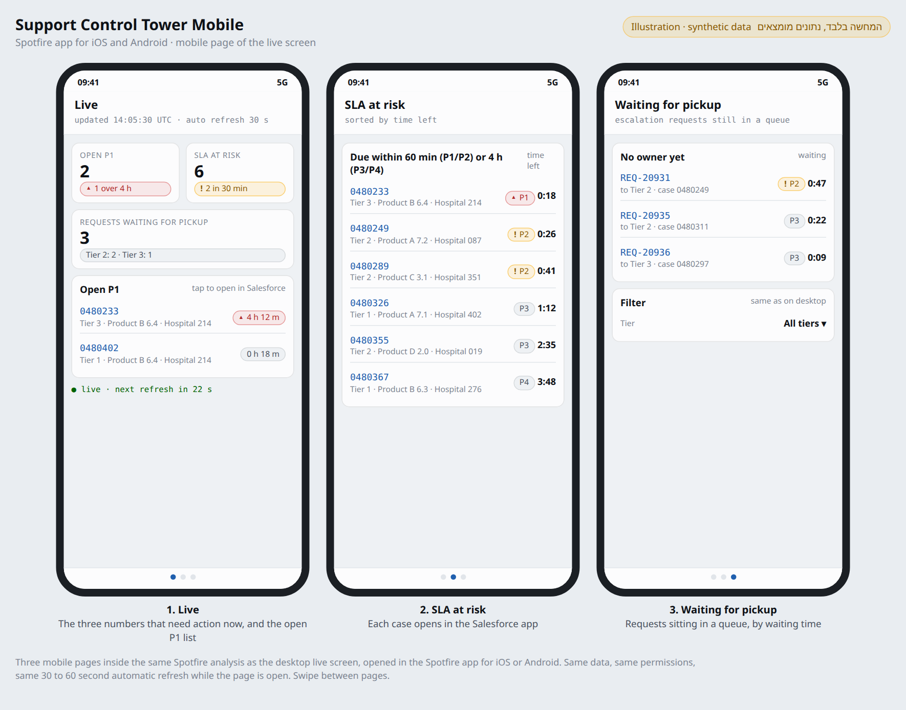

# Support Control Tower בטלפון: מסמך MVP

| | |
|---|---|
| **גרסה** | 3.0 (על גבי Spotfire, מיושר ל-MVP המקוצר 2.3) |
| **תאריך** | 2026-10-20 |
| **בעלים** | מנהל התמיכה הטכנית |
| **פלטפורמה** | אפליקציית Spotfire הרשמית ל-iOS ול-Android, מחוברת ל-Spotfire Cloud (גרסה אחרונה) |
| **תלוי ב** | ה-MVP המקוצר (MVP-Short): אותו ניתוח, אותם נתונים ואותו רענון |
| **מי בונה** | היועץ החיצוני שנבחר, כחלק מבניית המסך החי. IT מתחזק |
| **הדגמה** | איור בסעיף 1, וגרסה אינטראקטיבית (נתונים מומצאים): https://claude.ai/artifact/DDAnhE89An5LxPssAnnLVn |

---

## 0. ההחלטה בקצרה

**לא מפתחים אפליקציה.** ל-Spotfire יש אפליקציה רשמית לאייפון ולאנדרואיד שמתחברת ל-Spotfire Cloud, ו-Spotfire תומך בעמודים עם פריסה מותאמת לטלפון. לכן ה-MVP לטלפון הוא **שלושה עמודי טלפון בתוך אותו ניתוח של המסך החי**.

- **אותם נתונים ואותן הגדרות:** המספר בטלפון זהה למספר במחשב ובמסך הקיר.
- **אותו רענון:** עד 60 שניות מ-Salesforce למסך, ברענון אוטומטי כל 30-60 שניות, כל עוד העמוד פתוח.
- **עלות נוספת קטנה:** כ-1-2 ימי יועץ, מעבר למסך החי.

---

## 1. הבעיה והפתרון

**הבעיה:** התמיכה פועלת 24/7, בשלושה אזורי זמן ועם כוננים. ראשי הצוותים צריכים לדעת מה דורש טיפול גם כשהם לא ליד המחשב. מסך המחשב צפוף מדי לטלפון.

**הפתרון:** שלושה עמודים קצרים, שכל אחד מהם עונה על שאלה אחת:

| עמוד | השאלה |
|---|---|
| Live | כמה P1 פתוחים, כמה SLA בסיכון, וכמה בקשות ממתינות? |
| SLA at risk | איזה קייס יפרוץ ראשון? |
| Waiting for pickup | איזו בקשת אסקלציה עדיין יושבת בתור? |

מכל שורה, הקייס או הבקשה נפתחים באפליקציית Salesforce, ושם מטפלים בהם.

---

## 2. קהל היעד (Early Adopters)

| קבוצה | גודל | למה הם ראשונים |
|---|---|---|
| ראשי צוותים | 7 (3 בטיר 1, 2 בטיר 2, 2 בטיר 3) | הם מחליטים מי מטפל במה, ובטירים 2 ו-3 אחראים גם על הכוננים מחוץ לשעות העבודה |
| מנהל התמיכה | 1 | בעל המוצר, ואחראי על כל הטירים |

---

## 3. הפיצ'רים ההכרחיים (Core Features)

| # | פיצ'ר | מה בדיוק |
|---|---|---|
| M1 | **עמוד Live** | שלושה אריחים (P1 פתוחים, SLA בסיכון, בקשות שממתינות לשיוך), רשימת ה-P1 הפתוחים, וחותמת "עודכן לאחרונה" |
| M2 | **עמוד SLA at risk** | milestones שה-TargetDate שלהם בתוך 60 דקות (P1/P2) או 4 שעות (P3/P4), ממוינים לפי הזמן שנשאר |
| M3 | **עמוד Waiting for pickup** | Requests פתוחים שהבעלים שלהם הוא תור, ממוינים לפי זמן ההמתנה |
| M4 | **מסנן טיר** | אותו מסנן כמו במחשב |
| M5 | **קישור ל-Salesforce** | כל מספר קייס או בקשה נפתח כרשומה באפליקציית Salesforce |
| M6 | **רענון אוטומטי** | אותו מנגנון של המסך החי: כל 30-60 שניות, בלי לחיצה, כל עוד העמוד פתוח. אם הנתונים בני יותר מ-5 דקות, מוצגת אזהרה |
| M7 | **אבטחה** | כניסה עם SSO של החברה (Entra ID), גישה רק ממכשיר מנוהל, ובלי פרטי מטופלים בעמודים |

**כללי עיצוב:**
- **עמודים ייעודיים לטלפון,** ולא הסידור האוטומטי של עמוד המחשב.
- **עד 3-4 רכיבים בכל עמוד:** מספרים גדולים ורשימות קצרות. בלי טבלאות רחבות.
- **אותן views ב-DW** כמו המסך במחשב, כדי שהמספרים יהיו זהים.
- **אנגלית,** כמו במחשב, כי ראשי הצוותים יושבים בארה"ב, בבריטניה ובישראל.

**בחוץ, בכוונה (כמו ב-MVP המקוצר):**

| לא ב-MVP | למה |
|---|---|
| התראות (P1 ו-SLA) | אוטומציה ב-Salesforce, ולא חלק מ-Spotfire. **ב-MVP הזה לא מתוכננות התראות push מאפליקציית Spotfire**, ולכן הטלפון הוא מקום לבדוק בו את המצב, ולא ערוץ התראה |
| עמודי טלפון לעומס, לטרנדים, ל-R&D ולבתי חולים | ייבנו בגלים הבאים, ביחד עם הדשבורדים במחשב |
| דוחות PDF | גל שני |
| אפליקציה ייעודית | ירד מהפרק (סעיף 6) |

---

## 4. מדדי הצלחה (KPIs)

הניסוי רץ באותם 4 שבועות של ניסוי המסך החי.

| מדד | יעד | איך מודדים |
|---|---|---|
| שימוש בטלפון | לפחות 5 מתוך 7 ראשי הצוותים פותחים את עמודי הטלפון לפחות פעם בשבוע | לוג הגישה של Spotfire, לפי סוג מכשיר |
| עדכניות | עד 60 שניות מ-Salesforce לעמוד, ב-95% מהזמן | בדיקה יזומה: שינוי Priority של קייס בדיקה, ומדידת הזמן עד שהשינוי מופיע בטלפון |
| זמן טעינה | פחות מ-5 שניות לעמוד ברשת סלולרית | בדיקה על הטלפונים של המשתמשים |
| אמינות | אותם מספרים בטלפון ובמחשב, ב-100% מהבדיקות | בדיקה מדגמית |
| אבטחה | 0 אירועי אבטחה, וכל המכשירים עומדים במדיניות | דוח Intune / Conditional Access |

---

## 5. לוח זמנים ותקציב

**עמודי הטלפון נבנים בתוך לוח הזמנים של המסך החי, ולא אחריו.**

| שבוע (של ה-MVP המקוצר) | מה קורה לטלפון | מי |
|---|---|---|
| **1** | בדיקת ההיתכנות של הרענון האוטומטי כוללת גם את אפליקציית Spotfire בטלפון. IT מגדיר Conditional Access | יועץ, IT |
| **2-3** | שלושת עמודי הטלפון נבנים ביחד עם המסך החי | יועץ |
| **4** | בדיקות על הטלפונים של 8 המשתמשים (iOS ו-Android): רענון, קישורים לאפליקציית Salesforce, זמן טעינה. עלייה לאוויר ביחד עם המסך החי | יועץ, ראשי צוותים, IT |
| **5-8** | ניסוי ומדידה | מנהל התמיכה |

| רכיב | כמות משוערת | סכום |
|---|---|---|
| יועץ: שלושה עמודי טלפון ובדיקות | כ-1-2 ימי עבודה, מעבר לבניית המסך החי | לפי הצעת המחיר של היועץ |
| רישוי Spotfire לטלפון | אותם 8 משתמשים | **לבדיקה מול הספק** אם האפליקציה כלולה ברישיון הקיים |
| IT: Conditional Access ובדיקות | כ-1-2 ימי עבודה | זמן פנימי |
| אפליקציית Salesforce | קיימת | 0 |

> **ההערכות הן שלי ונועדו לתת סדר גודל.**

---

## 6. מה עם אפליקציה ייעודית?

ההחלטה היא להתמקד ב-Spotfire, ולכן אפליקציה ייעודית (שפותחת קוד, שרת והפצה) ירדה מהפרק. **הסיבה היחידה לחזור לבחון אותה בעתיד** היא צורך שאפליקציית Spotfire לא נותנת, למשל:
- התראות push עם אישור קבלה והסלמה אוטומטית אם אף אחד לא אישר.
- פעולות מתוך הטלפון (שיוך קייס, שינוי סטטוס). את אלה אפליקציית Salesforce כבר עושה.

גם אם יעלה צורך כזה, קודם צריך לבדוק אם אוטומציה ב-Salesforce או באפליקציית Salesforce פותרת אותו, לפני שבונים אפליקציה.

---

## 7. סיכונים

| סיכון | השפעה | מיטיגציה |
|---|---|---|
| הרענון האוטומטי לא עובד באפליקציית Spotfire בטלפון, גם אם הוא עובד במחשב | העמוד לא "חי" בטלפון | לבדוק את הטלפון כחלק מבדיקת ההיתכנות של שבוע 1 |
| הרענון עוצר כשהאפליקציה ברקע | המשתמש רואה נתונים ישנים כשהוא חוזר לאפליקציה | אזהרה בולטת כשהנתונים בני יותר מ-5 דקות, ורענון מיידי כשחוזרים לעמוד (לבדוק) |
| המשתמשים מצפים לקבל התראות מהטלפון | P1 מתפספס | להבהיר מראש: ההתראות מגיעות מ-Salesforce, והטלפון משמש רק לבדוק את המצב |
| קישורים נפתחים בדפדפן ולא באפליקציית Salesforce | עוד כניסה עם סיסמה | לבדוק בשבוע 4 על iOS ועל Android, ולהתאים את פורמט הקישור |
| נתונים נשמרים על המכשיר, והמכשיר אובד | HIPAA | בלי פרטי מטופלים בעמודים; גישה רק ממכשיר מנוהל; מחיקה מרחוק דרך Intune |
| טלפונים אישיים (BYOD) | אין שליטה במה שנשמר | Conditional Access שמחייב מכשיר מנוהל, ולבדוק מול הספק אם האפליקציה נתמכת ב-Intune App Protection |

---

## 8. נקודות לבדיקה

| # | נקודה | מול מי |
|---|---|---|
| 1 | האם אפליקציית Spotfire לטלפון כלולה ברישיונות הקיימים | ספק Spotfire |
| 2 | האם הרענון האוטומטי (Action mod או סקריפט) עובד גם באפליקציה לטלפון | יועץ, בשבוע 1 |
| 3 | האם הכניסה ל-Spotfire Cloud דרך Entra ID תומכת ב-Conditional Access | IT |
| 4 | איך קישור ל-Salesforce נפתח מתוך אפליקציית Spotfire | IT (בדיקה על מכשיר) |
| 5 | טלפונים של החברה, אישיים, או שניהם | IT / Security |

